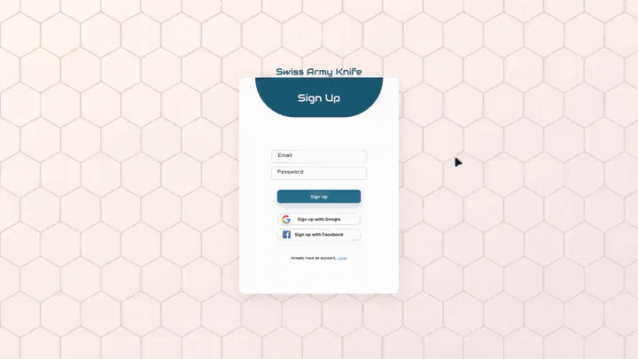

# Swiss Army Knife

A browser-based collection of everyday developer and security utilities, bundled into a single dashboard web app.

## Demo

_A quick walkthrough of the dashboard and its tools._

## What It Provides

- **Password Tools** — Check password strength with a live checklist, and generate cryptographically strong passwords.
- **Hash Tool** — Compute MD5, SHA-1, SHA-256, SHA-384, and SHA-512 hashes for text or files, plus verify hashes against expected values.
- **Encoder Tool** — Encode/decode Base64 and Base32, and convert text with Hex, Caesar cipher, and ROT13.
- **Compression Tool** — Compress/decompress files with GZIP and create/extract ZIP archives, all client-side.
- **Exiftool** — Inspect file metadata (size, MIME type, modified date, EXIF data, PDF info).
- **IP Info Tool** — Look up public IP geolocation details (country, region, city, ISP, ASN, timezone, proxy/hosting flags).

All processing happens in the browser — no uploads or server required.

---

The dashboard itself includes a collapsible sidebar for navigation, tool cards linking to each utility, a logout confirmation dialog, a loading screen, and a help/feedback menu.
